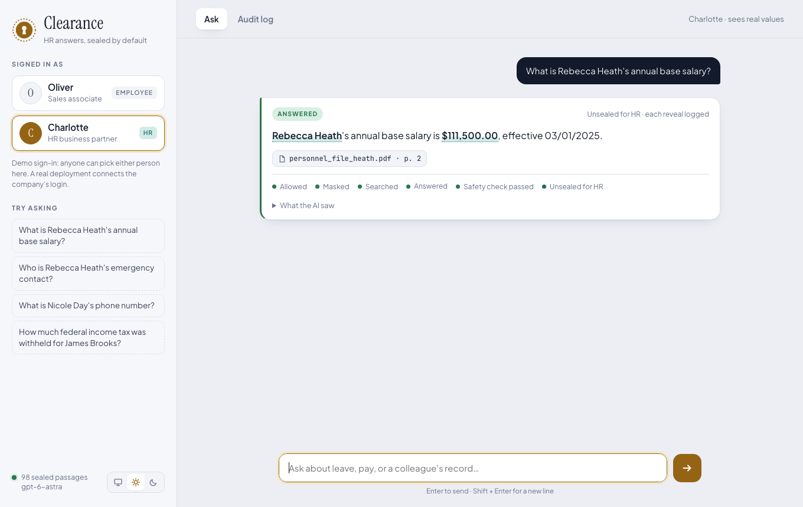
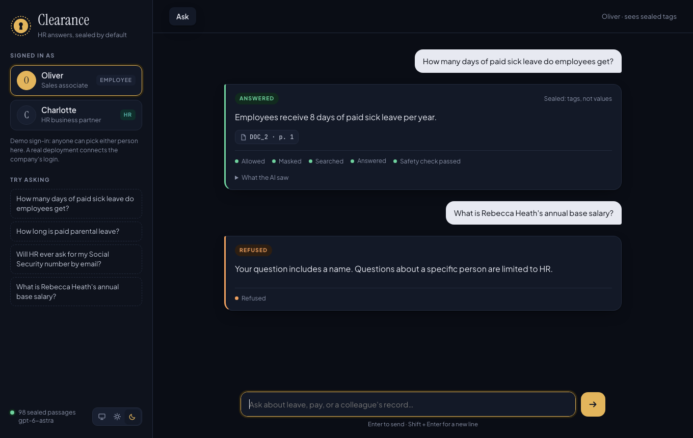
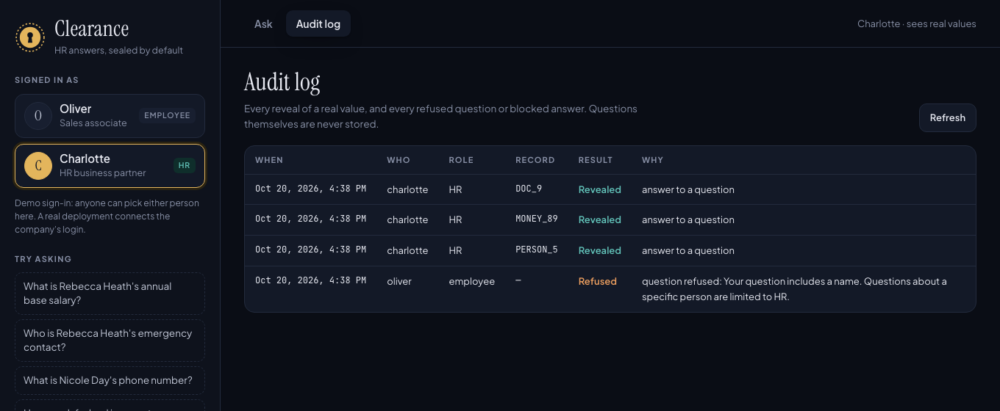

# Clearance: a privacy-safe RAG assistant for HR documents

[](https://github.com/WajidShaik10/clearance-privacy-rag/actions/workflows/ci.yml)

Ask plain-English questions about HR, payroll and tax documents and get answers with page citations, **without the AI model ever seeing personal data**. Names, SSNs, salaries and bank details are replaced with placeholders like `PERSON_5` before anything is stored or sent to the model. The real values sit in an encrypted vault; only HR can unseal them, and every reveal is logged.



| An employee: policy answered, personal question refused | HR's audit log: every reveal and refusal |
|---|---|
|  |  |

## How it works


**Phase 1, preparing documents (once):** read each PDF page by page (OCR for scans) → find personal data → replace it with placeholders and lock the real values in the encrypted vault → split into chunks → embed and store **only masked text** in the search library.

**Phase 2, answering a question:** check who is asking (employees can't ask about a specific person) → mask the question → hybrid search → the AI answers from masked passages with citations → a final safety check blocks any answer with real data or made-up placeholders → HR sees real values (each reveal logged), everyone else sees placeholders.

The core idea: **the AI cannot leak what it never sees.** Every other layer is a backup.

## Quick start (Docker)

You need Docker and an OpenAI API key.

```bash
cp .env.example .env
# In .env: paste your OPENAI_API_KEY, and two vault keys made with:
openssl rand -base64 32 | tr '+/' '-_'     # run twice: one for each VAULT_ key
docker compose up --build
```

Open **http://127.0.0.1:8000**. The first start prepares the 22 test documents (about a minute). The vault and search library live in Docker volumes; secrets come from `.env` at run time and are never built into the image. The app is published on 127.0.0.1 only.

**Keep a copy of your vault keys.** Without them the vault can never be opened again.

## Results

Measured on the fake test documents and on unseen data (see [Evaluation](#evaluation) for how to rerun each one).

| What | Result |
|---|---|
| Private values found in our 22 documents (answer key) | **381 / 381**, no false alarms on the policy document |
| Private values found in **unseen** documents (Gretel, held-out half) | **68.1%** (was 41.0% before improving on the other half) |
| Private values left after masking all 22 documents | **0** |
| Private values in the search library files | **0** |
| Search finds the right page (12 questions) | **12 / 12** hybrid (meaning only: 9 / 12) |
| HR answers contain the correct value (live, OpenAI) | **12 / 12** |
| Real model obeyed an instruction hidden in a document | **0 / 3** |
| Automated tests | **371 passing** |
| CI on every push (GitHub Actions, clean Linux machine) | **All tests pass** and the Docker image builds |

CI paid off on its first run: it failed on a clean machine because the search model's tokenizer file is only downloaded on first use, which never showed up on a laptop where the model was already cached. Reproducing it with an empty home folder led to a three-line fix.

## Protections, layer by layer

| Layer | What it does |
|---|---|
| Detection | Patterns with validity checks (SSA rules, bank routing checksum, context words), labelled fields, HR's employee roster with name variants, and spaCy for other names |
| Masking | Same value, same placeholder across all documents; file names become `DOC_n`; hidden PDF titles are dropped; placeholder-shaped text written by people (`SSN_1`) is defanged |
| Vault | Fernet encryption plus keyed HMAC fingerprints (two separate keys), so lookups never decrypt; every reveal and refusal is logged, never the question text |
| Search library | Holds masked chunks only, and is written by a separate process that never held real data (an attack test found leftover memory in a library file) |
| Roles | Unknown roles denied; employees refused on questions that name or point at people, before any search or AI call |
| AI call | Only masked text is sent; structured JSON answers so citations are checked; `store=False` so OpenAI keeps no copy |
| Final check | Fails closed: blocks answers with any real private value, a made-up placeholder, or one the AI was never shown |
| Chat page | Role decided on the server; switching person clears the chat; all text inserted as plain text |

## Known limitations

- **Detection is not complete.** 68% on unseen documents: names with no label or context, and non-US ID formats, are missed. Credit cards, passports, PINs and passwords are not detected yet.
- **Sign-in is a demo.** You pick Oliver (employee) or Charlotte (HR). A real deployment needs the company's login.
- **Employees can't ask about their own data** (it would need a link between a login and a placeholder).
- **All money amounts are hidden**, including tax thresholds on forms: safer, but some rule questions get masked numbers.
- **Word-based question rules can be dodged**; masking and the final check still keep the answer sealed.

## Path to production

This is a working prototype, tested on fictional data. A real deployment would need:

| Area | Today | Production |
|---|---|---|
| Sign-in | Demo picker (Oliver or Charlotte) | Company single sign-on, with roles from the HR system |
| Detection | 68% recall on unseen documents | Higher recall, card and passport detection, and human review of documents before ingestion |
| Keys | `.env` file on one machine | A key management service (AWS KMS, Azure Key Vault) with rotation and access controls |
| Hosting | 127.0.0.1 only | HTTPS, network controls, backups, monitoring and alerting |
| AI provider | OpenAI with `store=False` | A data processing agreement and zero data retention with the provider |
| Compliance | None | Review against privacy law (GDPR, CCPA) and company policy, and an independent penetration test |
| Operations | Audit log in SQLite | Central logging, incident response, and regular access reviews |

## Run without Docker

```bash
python3 -m venv .venv && source .venv/bin/activate
pip install -r requirements.txt -r requirements-dev.txt
python -m spacy download en_core_web_lg   # name-finding model (~400 MB)
brew install tesseract                    # OCR for scanned pages
python -m src.vault                       # create the two vault keys in .env (never committed)
# add OPENAI_API_KEY to .env (see .env.example)
python scripts/ingest.py                  # read -> mask -> chunk -> embed -> store
python -m app                             # chat page at http://127.0.0.1:8000
```

From the terminal:

```bash
python -m src.pipeline "How many days of paid sick leave do employees get?" --user oliver --role employee
# [answered] Employees receive 8 days of paid sick leave per year. [DOC_2, page 1]

python -m src.pipeline "What is Rebecca Heath's annual base salary?" --user oliver --role employee
# [refused] Your question includes a name. Questions about a specific person are limited to HR.

python -m src.pipeline "What is Rebecca Heath's annual base salary?" --user charlotte --role hr
# [answered] Rebecca Heath's annual base salary is $111,500.00, effective 03/01/2025. [personnel_file_heath.pdf, page 2]
```

## Evaluation

**CI/CD:** every push runs all tests on a clean Linux machine and checks the Docker image builds ([`ci.yml`](.github/workflows/ci.yml)). Publishing a release builds the image and pushes it to GitHub Container Registry ([`release.yml`](.github/workflows/release.yml)). No secrets are used: the one live OpenAI test skips itself without a key.

```bash
pytest                                   # 371 tests (offline; no API calls)
python scripts/evaluate_detection.py     # detection vs the answer key
python scripts/evaluate_unseen.py test   # detection on unseen documents (Gretel, held-out half)
python scripts/evaluate_search.py        # vector vs keyword vs hybrid search
python scripts/evaluate_answers.py       # live: HR answer accuracy + prompt-injection test (~15 OpenAI calls)
```

`tests/test_attacks.py` attacks the system with stand-ins for OpenAI that misbehave on purpose (dumping every passage, obeying an injected instruction, inventing SSNs). What the attacks found, and fixed: a typed placeholder got past the employee rules; placeholder text in a document would have been unmasked as real; an SSN written with spaces slipped past the final check; search dropped the right chunk when only keyword search found it; a library file held real values from leftover memory.

## Project layout

| File | Diagram steps | Job |
|---|---|---|
| `src/extract.py` | 1, 2 | Read PDFs page by page (OCR for scans), plus hidden metadata |
| `src/detect.py` | 3, 11 | Find personal data, in documents and in answers |
| `src/mask.py` | 4, 8, 13 | Swap real values and placeholders |
| `src/vault.py` | safe, 16 | Encrypted store and audit log |
| `src/index.py` | 5, 9 | Chunk, embed, store and search masked passages |
| `src/answer.py` | 10 | Ask the AI model (OpenAI) |
| `src/roles.py` | 7, 12 | Who may ask what, who sees real values |
| `src/pipeline.py` | 6, 14, 15 | Run a question through every step |
| `app/` | | Chat page (FastAPI + HTML/CSS/JS) |
| `scripts/` | | Fake data, ingestion and evaluation |

**Stack:** Python 3.14, PyMuPDF, Tesseract, spaCy, cryptography (Fernet, HMAC), ChromaDB with MiniLM embeddings, BM25, OpenAI (gpt-6-astra), FastAPI, Docker.

## Test data

All test documents are fake. `scripts/make_fake_docs.py` invents 12 employees and 2 contractors with Faker (fixed seed, so the output is the same every run) and writes them onto real blank IRS forms (W-2, W-4, W-9 from irs.gov) and onto generated payslips, personnel files, a directory and a payroll register. Two documents are scanned images, to test OCR. Phone numbers use the reserved 555-01xx range and emails use `example.com`. `data/answer_key.json` lists all 381 private values and their pages.

A [demo script](docs/demo-script.md) walks through the app in five minutes.
