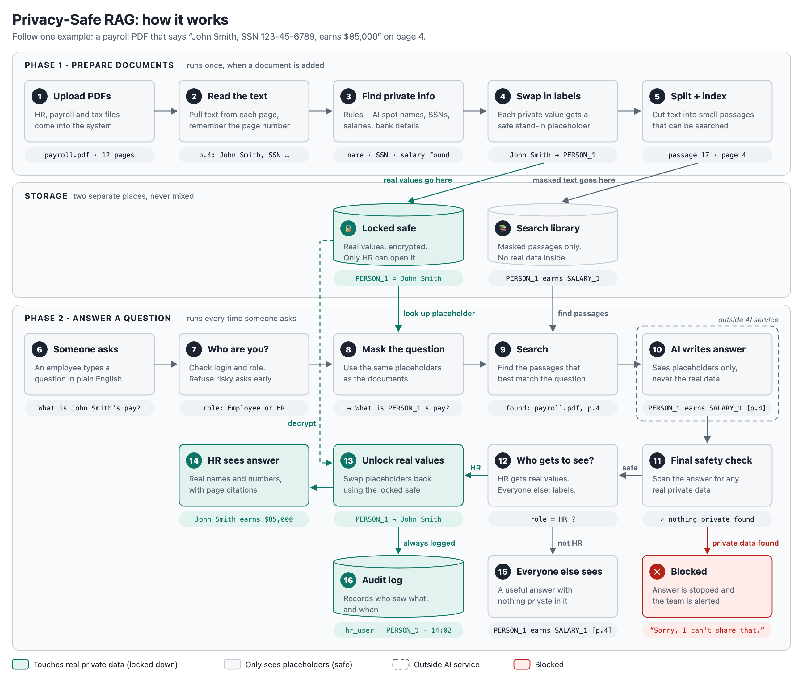

 # Privacy-Safe RAG

Ask plain-English questions about HR, payroll and tax documents and get answers with page citations, without exposing personal data. Real values (SSNs, names, salaries, bank details) are replaced with placeholders like `PERSON_1` before anything is stored or sent to an AI model. Only HR can see the real values, and every reveal is logged.



## Code layout

| File | Diagram steps | Job |
|---|---|---|
| `src/extract.py` | 1, 2 | Read PDFs page by page |
| `src/detect.py` | 3, 11 | Find private info (documents and answers) |
| `src/mask.py` | 4, 8, 13 | Swap real values ↔ placeholders |
| `src/vault.py` | safe, 16 | Encrypted store + audit log |
| `src/index.py` | 5, 9 | Store and search masked passages |
| `src/answer.py` | 10 | Ask the AI model |
| `src/roles.py` | 7, 12 | Who can ask what, who sees real values |
| `src/pipeline.py` | 6, 14, 15, blocked | Run a question through every step |

## Setup

```bash
python3 -m venv .venv
source .venv/bin/activate
pip install -r requirements.txt
python -m spacy download en_core_web_lg   # name-finding model (~400 MB)
brew install tesseract                    # OCR for scanned pages
python -m src.vault                       # create the two vault keys in .env (never committed)
python scripts/make_fake_docs.py          # 22 fake PDFs + data/answer_key.json
pytest
python scripts/evaluate_detection.py      # PII detection score vs the answer key
python scripts/evaluate_unseen.py test    # PII detection score on unseen documents (Gretel)
python scripts/ingest.py                  # read -> mask -> chunk -> embed -> store (data/vault, data/index)
python scripts/evaluate_search.py         # does search find the right page? (vector vs keyword vs hybrid)
python scripts/evaluate_answers.py        # live: are HR's answers right? does the AI obey a hostile document?
```

## Attack tests

`tests/test_attacks.py` attacks the system with stand-ins for OpenAI that misbehave on purpose (dumping every passage, obeying an instruction hidden in a document, inventing SSNs). `scripts/evaluate_answers.py` runs the live checks: 12/12 HR answers hold the correct value, and the real model ignored the hidden instruction.

What the attacks found and fixed:
- Typing a placeholder (`What is PERSON_5's salary?`) got past the employee rules: now refused.
- Placeholder-shaped text in a document (`SSN_1`) would have been treated as real: now defanged to `SSN-1`.
- An SSN written with spaces (`123 45 6789`) slipped past the final check: now caught.
- Search dropped the right chunk when only keyword search found it: chunks naming the asked-about person now come first.
- A search-library file written in the same process that read raw PDFs held real values from leftover memory: the library is now written by a separate process that only receives masked chunks.

## Ask a question

Needs `OPENAI_API_KEY` in `.env` (see `.env.example`) and a built library (`python scripts/ingest.py`).

```bash
python -m src.pipeline "How many days of paid sick leave do employees get?" --user ravi --role employee
# [answered] Employees receive 8 days of paid sick leave per year. [DOC_2, page 1]

python -m src.pipeline "What is Rebecca Heath's annual base salary?" --user ravi --role employee
# [refused] Questions about a specific person (person) are limited to HR.

python -m src.pipeline "What is Rebecca Heath's annual base salary?" --user priya --role hr
# [answered] Rebecca Heath's annual base salary is $111,500.00, effective 03/01/2025. [personnel_file_heath.pdf, page 2]
```

## Test data

All test documents are fake. `scripts/make_fake_docs.py` invents 12 employees and 2 contractors with Faker (fixed seed, so the output is the same every run). It writes their details onto real blank IRS forms (W-2, W-4, W-9 from irs.gov) and onto generated payslips, HR files and a payroll register. Two documents are also saved as scanned images to test OCR. Phone numbers use the reserved 555-01xx range and emails use `example.com`.

`data/answer_key.json` lists every private value and the page it appears on, so we can measure exactly what the PII detector catches.
